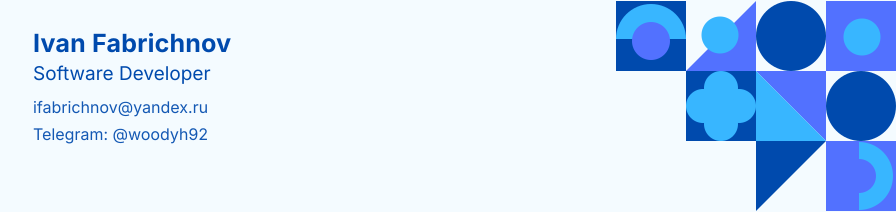

  

**[Telegram](https://t.me/woodyh92)** · **[LinkedIn](https://www.linkedin.com/in/ivanfabrichnov/)** · **[GitHub](https://github.com/IFabrichnov)** · **[ifabrichnov@yandex.ru](mailto:ifabrichnov@yandex.ru)**

---

### 🛠 Навыки

| Категория | Навыки |
|---|---|
| **Языки и фронтенд** | `JavaScript` `TypeScript` `React` `Redux` `HTML` `CSS` `SASS / LESS` |
| **UI и вёрстка** | `Bootstrap` `Material UI` `Foundation email` |
| **Бэкенд и данные** | `ColdFusion (CFML)` `ExpressJS` `SQL` `PostgreSQL` `MySQL` `MongoDB` |
| **ИИ и LLM** | `Langflow` `Open WebUI` `MCP-серверы` `Hermes` `LLM-пайплайны` |
| **Инструменты** | `Git` `Docker` `Postman` `Figma` |
| **Сильная сторона** | чтение и разбор незнакомого кода (Python, CFML, JavaScript) |

---

### 🎖 Аттестации

| Аттестация | Выдана | Дата |
|---|---|---|
| Professional Training Course «Mid-Level Web Developer» | Яндекс Практикум | март 2025 |
| React. Development of Complex Front-end Applications | html academy | апр. 2024 |
| SQL для продвинутых специалистов / SQL for Advanced Professionals | Университет Иннополис | дек. 2023 |
| Professional HTML & CSS, level 1 | html academy | апр. 2018 |

---

 

